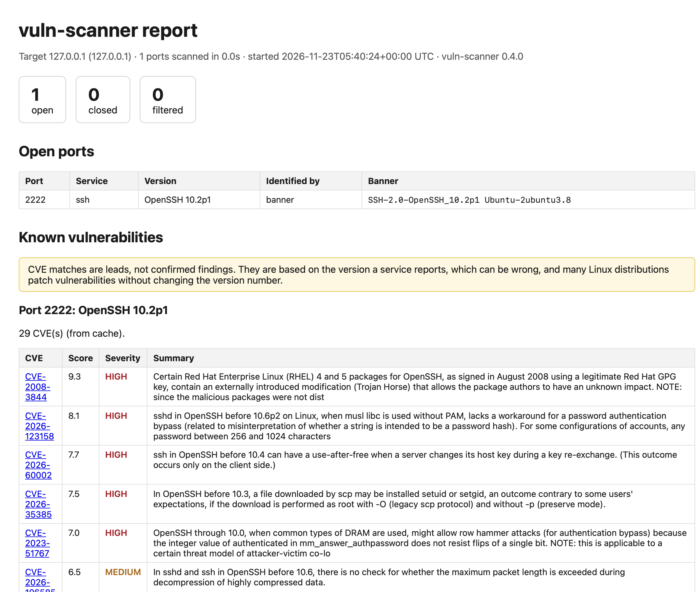

# vuln-scanner

A small network scanner in Python. It finds open TCP ports, identifies the service behind each one from its banner, looks up known CVEs for that product and version in the National Vulnerability Database (NVD), and writes the results to the terminal, JSON, or a standalone HTML report.

I built it while studying Information Technology at Northeastern, to learn how scanners like Nmap and Nessus work under the hood: connect, grab a banner, fingerprint the service, match it against a vulnerability database.

> **Only scan systems you own or have written permission to test.** The scanner refuses public IP addresses unless you pass `--allow-public`.



## What it does

- **Scans** TCP ports with a threaded connect scan and classifies each as open, closed, or filtered.
- **Grabs banners.** It reads what a service announces on connect, and sends a minimal HTTP `HEAD` request to common web ports.
- **Identifies services** (SSH, HTTP, SMTP, FTP) and extracts the product and version. Without a banner it falls back to the well-known port number and marks that as lower confidence.
- **Looks up CVEs** (`--cve`) for each product and version through the NVD API, with a 24-hour local cache and rate-limit handling.
- **Reports** as terminal output, JSON (`--json`), or a self-contained HTML page (`--html`).
- **Tested** with 120 unit tests. None of them touch the real network.

## Example

Run against an Ubuntu Server VM in my own lab:

```
$ python3 -m scanner 127.0.0.1 --ports 2222 --cve
Scanning 127.0.0.1 (127.0.0.1), 1 port(s)...
PORT    SERVICE     VERSION                   BANNER
2222    ssh         OpenSSH 10.2p1            SSH-2.0-OpenSSH_10.2p1 Ubuntu-2ubuntu3.8
Done in 0.0s: 1 open, 0 closed, 0 filtered.

Known vulnerabilities (from the NVD, based on the versions services claim; verify before acting):
  2222  OpenSSH 10.2p1: 29 CVE(s), highest 9.3 HIGH
      CVE-2008-3844   9.3  HIGH     Certain Red Hat Enterprise Linux (RHEL) 4 and 5 packages for OpenSSH, ...
      CVE-2026-123158 8.1  HIGH     sshd in OpenSSH before 10.6p2 on Linux, when musl libc is used without PAM, ...
```

The top result is a good example of why matches are leads and not findings. See [Limitations](#limitations).

## Usage

Requires Python 3.9+ and no third-party packages.

```
python3 -m scanner <target> [--ports PORTS] [--timeout SECONDS] [--workers N]
                            [--cve] [--cache-file FILE]
                            [--json FILE] [--html FILE] [--allow-public]
```

| Option | Default | Meaning |
|---|---|---|
| `--ports` | `1-1024` | Ports to scan, e.g. `22,80,8000-8010` |
| `--timeout` | `0.5` | Connect timeout in seconds |
| `--workers` | `100` | Parallel connections (1-500) |
| `--cve` | off | Look up CVEs in the NVD (sends only product and version) |
| `--cache-file` | `~/.cache/vuln-scanner/nvd-cache.json` | Where NVD answers are cached for 24 hours |
| `--json FILE` | | Write results as JSON |
| `--html FILE` | | Write a standalone HTML report |
| `--allow-public` | off | Allow public IP addresses (only with permission) |

A free [NVD API key](https://nvd.nist.gov/developers/request-an-api-key) raises the rate limit from 5 to 50 requests per 30 seconds. The scanner reads it from the `NVD_API_KEY` environment variable. It is deliberately not a command-line option, so it never ends up in shell history.

```
export NVD_API_KEY="your-key"
python3 -m scanner 192.168.56.101 --cve --html report.html
```

To try it without scanning anything else, start a local test service:

```
python3 -m http.server 8000
python3 -m scanner 127.0.0.1 --ports 8000
```

## How it works

1. **Scan.** A thread pool opens TCP connections. A completed connection means open, a refusal means closed, and a timeout means filtered (usually a firewall).
2. **Banner.** On an open port the scanner reads up to 200 characters. On HTTP ports it sends `HEAD /` first. Control characters are stripped, because the banner is text chosen by the remote host.
3. **Fingerprint.** Regular expressions pull the product and version out of banners such as `SSH-2.0-OpenSSH_9.6p1` or `Server: nginx/1.24.0`, and product names are mapped to canonical names.
4. **CPE.** The product and version become a [CPE 2.3](https://nvd.nist.gov/products/cpe) name, the identifier NVD uses (`OpenSSH 9.6p1` becomes `cpe:2.3:a:openbsd:openssh:9.6:p1`).
5. **Query.** The scanner asks the NVD for CVEs affecting that exact CPE, once per unique product and version, and caches the answer.
6. **Report.** Results are sorted by CVSS score, highest first.

## Safety choices

- Public addresses are refused unless `--allow-public` is set.
- Only a product name and version leave your machine for the NVD. The target address never does.
- Banners and NVD text are untrusted input. The HTML report escapes everything, blocks scripts and remote resources with a Content-Security-Policy, and links only to NVD pages built from CVE IDs that match a strict pattern. The tests include a hostile banner and a malicious fake NVD response.
- The scanner tells you when it could not check a service ("no NVD mapping", "no version", "lookup failed") instead of reporting zero vulnerabilities.

## Limitations

This is a learning project, not a replacement for Nmap or a commercial scanner.

- **CVE matches are leads, not findings.** The scanner only knows the version a service reports. Real output from my own VM shows why:
  - `CVE-2008-3844` scored 9.3 and ranked first, but it describes tampered Red Hat packages from 2008. NVD lists it against every OpenSSH version, and my VM runs Ubuntu.
  - `CVE-2023-51767` says "through 10.0" but matched version 10.2p1, because NVD's version data for it is loose.
  - Ubuntu and other distributions backport security fixes without changing the upstream version number. The banner `Ubuntu-2ubuntu3.8` hints that patches may already be applied.
- **Banners can lie.** An administrator can hide or fake a banner, so a missing or wrong version does not prove anything.
- **Limited coverage.** TCP connect scans only (no UDP, no SYN scan, no IPv6). Fingerprinting covers SSH, HTTP, SMTP and FTP, and only a fixed set of products maps to NVD (OpenSSH, nginx, Apache, vsftpd and a few others). TLS services are not inspected.
- **Not stealthy.** A connect scan is logged by the target. That is fine for your own lab and wrong anywhere else.

## Project structure

```
scanner/
  portscan.py      # threaded TCP connect scan and banner grabbing
  services.py      # banner -> service, product, version
  cve.py           # CPE builder, NVD client, rate limiting, 24h cache
  report.py        # scan results -> dictionary / JSON
  html_report.py   # dictionary -> standalone HTML page
  cli.py           # command-line interface
tests/             # 120 unit tests, no real network access
```

## Running the tests

```
python3 -m unittest discover -s tests -t .
```

## Roadmap

- [x] TCP connect scan with banner grabbing
- [x] Service and version identification
- [x] CVE lookup through the NVD
- [x] JSON and HTML reports
- [ ] More NVD product mappings
- [ ] Compare two scans and report what changed
- [ ] Live-tested against more services

## Data source

This product uses data from the NVD API but is not endorsed or certified by the NVD.
